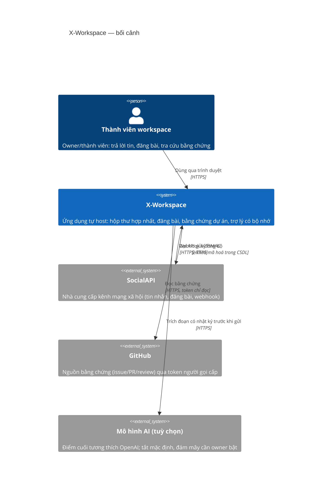
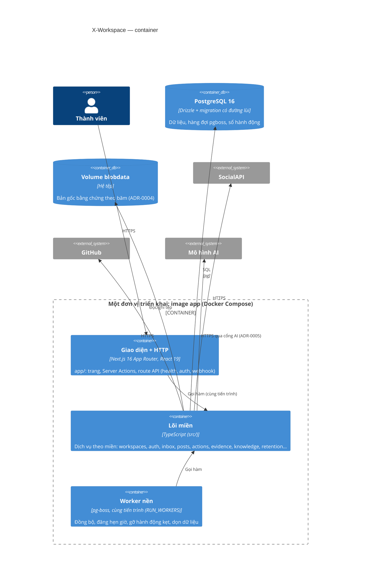

# Kiến trúc X-Workspace (C4 mức 1–2)

Quyết định kiểu kiến trúc: [ADR-0007](adr/0007-modular-monolith.md) (một khối triển khai). Miền và thư mục: [architecture/domains.md](architecture/domains.md). Cập nhật: 2026-11-23.

## Mức 1 — Bối cảnh hệ thống

## Mức 2 — Container

## Điểm cuối công khai (BE-API-009)

Route handler trong `app/api/` là **danh sách công khai đã duyệt**; mọi route khác phải xác thực ở server. Test `tests/security/web-security.test.ts` so khớp thư mục với bảng này.

| Route                                    | Cách xác thực                                                         |
| ---------------------------------------- | --------------------------------------------------------------------- |
| `/api/auth/*`                            | Better Auth (đăng ký/đăng nhập; giới hạn tần suất; CSRF qua proxy)    |
| `/api/health`                            | công khai, chỉ đọc, không dữ liệu người dùng (`{status}` ok/degraded) |
| `/api/webhooks/socialapi/[connectionId]` | chữ ký HMAC-SHA256 trên thân thô + timestamp; secret theo kết nối     |

Trang và Server Action của `/app/*` luôn qua `requireUser`/`requireWorkspace` (`src/server/runtime.ts`).

## Quy tắc ranh giới (kiểm bằng test)

`tests/config/architecture.test.ts` giữ: `src/` không import `next`/`react` ngoài `src/server/` và `src/auth/client.ts`; hạ tầng (`pg`, `pg-boss`, `better-auth`) chỉ ở thư mục đã khai; tệp lõi thuần không import ORM/khung/mạng; không import `app/` từ `src/`; không vòng import; ngoài module chỉ import tệp cấp một hoặc `index.ts`. Chi tiết và đánh đổi: ADR-0007.
