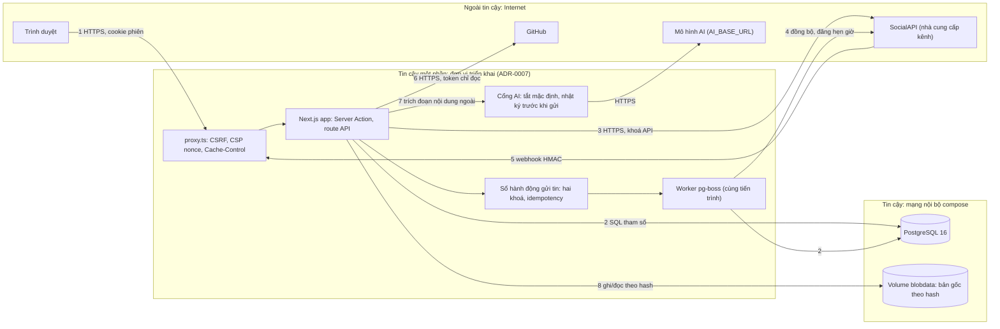

# THREAT-MODEL — X-Workspace · phiên bản 2 · 2026-11-23

> Chủ: chủ dự án · Duyệt: chưa có người duyệt riêng (phiên chính tự soạn theo ADR-0008 của khung; cần người chịu trách nhiệm bảo mật xem lại trước khi chạy thật) · Phạm vi: web app, CSDL, hàng đợi nền, kho bằng chứng, cổng AI, sổ hành động gửi tin, tích hợp nhà cung cấp mạng xã hội và GitHub · Ngoài phạm vi: hạ tầng host/reverse proxy của người triển khai, bảo mật phía nhà cung cấp (SocialAPI, GitHub, nhà cung cấp mô hình).

## 1. Tài sản

| ID   | Tài sản                                          | Phân loại | Ảnh hưởng nếu lộ / sửa / mất                                                   |
| ---- | ------------------------------------------------ | --------- | ------------------------------------------------------------------------------ |
| A-01 | Khoá API nhà cung cấp (`provider_connections`)   | bí mật    | Kẻ khác đăng bài, đọc tin nhắn khách hàng bằng danh nghĩa trang của người dùng |
| A-02 | Mật khẩu và phiên đăng nhập                      | bí mật    | Chiếm tài khoản, truy cập mọi workspace của nạn nhân                           |
| A-03 | Hộp thư (tin nhắn, bình luận của khách hàng)     | nhạy cảm  | Lộ dữ liệu cá nhân của bên thứ ba, rủi ro pháp lý                              |
| A-04 | Bài đăng và lịch đăng                            | toàn vẹn  | Đăng sai nội dung lên trang thật, mất uy tín                                   |
| A-05 | `APP_SECRET_KEY`, `BETTER_AUTH_SECRET`           | bí mật    | Giải mã mọi khoá API đã lưu, giả mạo phiên                                     |
| A-06 | Quyền thành viên workspace (`members`)           | toàn vẹn  | Leo quyền, xem/sửa dữ liệu workspace khác                                      |
| A-07 | Kho bằng chứng (bản gốc theo hash, `evidence_*`) | nhạy cảm  | Lộ nội dung issue/PR/tin của dự án; sửa bản gốc làm sai dòng thời gian         |
| A-08 | Sổ hành động gửi tin (`action_ledger`, `drafts`) | toàn vẹn  | Gửi trùng/trái phép tới khách hàng, mất dấu vết người nhận                     |
| A-09 | Nhật ký công bố AI (`ai_disclosures`)            | toàn vẹn  | Không chứng minh được dữ liệu nào đã rời máy                                   |

## 2. Thành phần, ranh giới tin cậy, luồng dữ liệu

Ranh giới tin cậy: **TB1** = Internet ↔ app (client↔server, bên thứ ba↔server) · **TB2** = app ↔ CSDL/kho tệp · **TB3** = app ↔ nhà cung cấp/GitHub · **TB4** = nội dung ngoài ↔ mô hình (cổng AI: luồng 7) · **agent↔tool**: mô hình **không có công cụ ghi**, chỉ nhận chữ và trả chữ; hành động ghi đi qua chính sách bằng mã và người duyệt (ADR-0005, ADR-0006).

Mỗi tích hợp bên ngoài trong cấu hình môi trường nằm trên sơ đồ: `SOCIALAPI_BASE_URL` (SocialAPI), `AI_BASE_URL` (mô hình AI), `BLOB_DIR` (volume blobdata), `DATABASE_URL` (PostgreSQL), GitHub (hằng số `GITHUB_API_BASE`, token do người gọi cấp).

| Luồng | Từ → Đến                | Dữ liệu                                          | Qua ranh giới | Xác thực / mã hoá                                                                     |
| ----- | ----------------------- | ------------------------------------------------ | ------------- | ------------------------------------------------------------------------------------- |
| 1     | Trình duyệt → app       | đăng nhập, form, Server Action                   | TB1           | TLS (do reverse proxy), cookie phiên, kiểm Origin                                     |
| 2     | app → CSDL              | mọi dữ liệu; khoá API đã mã hoá                  | TB2           | mạng nội bộ compose, mật khẩu CSDL, truy vấn tham số                                  |
| 3     | app → nhà cung cấp      | khoá API, nội dung bài/tin gửi, truy vấn hộp thư | TB3           | chỉ https, khoá giải mã tại lúc dùng, timeout, không tự gửi lại khi chưa chắc         |
| 4     | worker → CSDL/NCC       | bài đến hạn, đồng bộ hộp thư, gửi tin            | TB2, TB3      | cùng cơ chế luồng 2 và 3                                                              |
| 5     | nhà cung cấp → app      | webhook tin đến                                  | TB1           | HMAC-SHA256 trên thân thô + timestamp, secret theo kết nối                            |
| 6     | app → GitHub            | issue/PR/review (đọc)                            | TB3           | token người gọi cấp mỗi lần (không lưu), chỉ theo trang cùng origin                   |
| 7     | app → cổng AI → mô hình | trích đoạn tin/bằng chứng                        | TB4           | tắt mặc định; đám mây chỉ khi owner bật; nhật ký ghi TRƯỚC khi gửi; trần 200.000 byte |
| 8     | app → volume blob       | bản gốc bằng chứng theo sha256                   | TB2           | khoá là hash đã kiểm định dạng, không đường phục vụ trực tiếp; kiểm hash khi đọc      |

## 3. Kẻ tấn công giả định

| Ai                          | Năng lực                                    | Mục tiêu                                                       |
| --------------------------- | ------------------------------------------- | -------------------------------------------------------------- |
| Người lạ trên Internet      | gửi request tuỳ ý, tự động, dò mật khẩu     | chiếm tài khoản, lấy dữ liệu, làm sập dịch vụ                  |
| Thành viên workspace khác   | tài khoản hợp lệ, biết/đoán ID tài nguyên   | xem/sửa dữ liệu của workspace không thuộc về mình              |
| Thành viên cấp thấp         | tài khoản `member` trong cùng workspace     | làm việc của admin (xoá kết nối, xem khoá)                     |
| Trang web độc hại           | lừa người dùng đang đăng nhập bấm/gửi form  | thực hiện hành động thay nạn nhân (CSRF, XSS)                  |
| Nhà cung cấp/nội dung ngoài | trả dữ liệu sai hình, nội dung chứa mã/lệnh | tiêm script, tiêm lệnh vào mô hình, làm app lỗi, lộ lỗi nội bộ |

## 4. Mối đe doạ theo luồng (STRIDE)

Mức = khả năng × tác động (Cao/TB/Thấp). Quyết định: mitigate / eliminate / transfer / accept. Mọi hàng **Cao** trỏ biện pháp cụ thể (test, cấu hình hoặc ID checklist); không hàng Cao nào ở quyết định accept.

| ID    | Luồng | STRIDE                   | Mối đe doạ cụ thể                                                       | Mức | Quyết định | Biện pháp                                                                                                                                                                                                                  | Bằng chứng                                                                                                                                 | Trạng thái |
| ----- | ----- | ------------------------ | ----------------------------------------------------------------------- | --- | ---------- | -------------------------------------------------------------------------------------------------------------------------------------------------------------------------------------------------------------------------- | ------------------------------------------------------------------------------------------------------------------------------------------ | ---------- |
| TM-01 | 1     | S Spoofing               | đánh cắp/đoán phiên                                                     | Cao | mitigate   | cookie HttpOnly + SameSite=Lax, `__Host-` + Secure trên https, token ≥ 128 bit, logout xoá phiên (BE-AUTH-004, FE-SEC-005)                                                                                                 | `tests/auth-integration/auth.test.ts`, `tests/security/web-security.test.ts`                                                               | đã giảm    |
| TM-02 | 1     | S Spoofing               | dò mật khẩu hàng loạt                                                   | Cao | mitigate   | Argon2id, giới hạn theo IP và khoá theo tài khoản (trần 15 phút), phản hồi đồng nhất                                                                                                                                       | `tests/auth/password.test.ts`, `tests/auth/throttle.test.ts`, `tests/auth-integration/auth.test.ts`                                        | đã giảm    |
| TM-03 | 1     | S Spoofing               | lộ tài khoản nào đã đăng ký                                             | TB  | mitigate   | đăng ký trùng email trả cùng phản hồi, đăng nhập sai báo chung, khoá không phân biệt email                                                                                                                                 | `tests/auth-integration/auth.test.ts`                                                                                                      | đã giảm    |
| TM-04 | 1     | T Tampering              | CSRF: trang ngoài POST bằng cookie nạn nhân                             | Cao | mitigate   | từ chối cross-site theo `Sec-Fetch-Site`/`Origin` ở proxy cho mọi request đổi trạng thái, SameSite=Lax, không GET đổi trạng thái (FE-FORM-010)                                                                             | `tests/security/csrf.test.ts`, `e2e/security-headers.spec.ts`                                                                              | đã giảm    |
| TM-05 | 1     | T Tampering              | XSS đánh cắp phiên/đổi hành động                                        | Cao | mitigate   | CSP nonce + strict-dynamic không `unsafe-inline`, `base-uri 'none'`, escape mặc định của React, không DOM sink, URL ngoài qua `safeUrl()` (FE-SEC-001/002/003)                                                             | `tests/security/headers.test.ts`, `tests/security/web-security.test.ts`, `tests/security/safe-url.test.ts`, `e2e/security-headers.spec.ts` | đã giảm    |
| TM-06 | 1     | T Tampering              | payload sai hình vượt validate phía client                              | Cao | mitigate   | kiểm ở server bằng hàm kiểm có kiểu (`ValidationError`; Zod cho cấu hình), từ chối giá trị lạ, chuẩn hoá NFC (BE-API-003)                                                                                                  | `tests/posts/service.test.ts`, `tests/accounts/service.test.ts`, `tests/security/web-security.test.ts`                                     | đã giảm    |
| TM-07 | 2     | I Information disclosure | IDOR: dùng ID của workspace khác                                        | Cao | mitigate   | mọi truy vấn kèm điều kiện workspace; sai workspace → NotFound, người ngoài → Forbidden                                                                                                                                    | `tests/auth/idor.test.ts`                                                                                                                  | đã giảm    |
| TM-08 | 2     | E Elevation of privilege | thành viên cấp thấp làm việc của admin                                  | Cao | mitigate   | ma trận quyền kiểm ở server cho từng hành động; mọi Server Action qua `requireWorkspace`/`requireUser` (PRF-WEB-004)                                                                                                       | `tests/auth/permissions.test.ts`, `tests/security/web-security.test.ts`                                                                    | đã giảm    |
| TM-09 | 2     | I Information disclosure | lộ khoá API qua DB/log/phản hồi                                         | Cao | mitigate   | AES-256-GCM, khoá chỉ giải mã lúc gọi nhà cung cấp, không trả về UI, logger che bí mật (kể cả query string URL) (SEC-SECRET-007)                                                                                           | `tests/security/secret-box.test.ts`, `tests/connections/service.test.ts`, `tests/log/logger.test.ts`                                       | đã giảm    |
| TM-10 | 2     | T Tampering              | SQL injection                                                           | Cao | mitigate   | truy vấn tham số qua Drizzle; test cấm `sql.raw` ngoài schema, cấm nối chuỗi vào câu SQL và chạy lệnh hệ thống (SEC-WEB-001)                                                                                               | `tests/security/web-security.test.ts`, `tests/config/web-hygiene.test.ts` (quét SAST CodeQL ở CI)                                          | đã giảm    |
| TM-11 | 3     | I Information disclosure | khoá API gửi qua kênh không mã hoá                                      | Cao | mitigate   | `SOCIALAPI_BASE_URL` chỉ nhận https, không có cờ tắt xác minh TLS                                                                                                                                                          | `tests/config/deploy.test.ts`                                                                                                              | đã giảm    |
| TM-12 | 3, 4  | T Tampering              | phản hồi nhà cung cấp sai hình/độc hại                                  | TB  | mitigate   | parse và kiểm schema từng phản hồi, lỗi nhà cung cấp quy về mã chung không lộ chi tiết                                                                                                                                     | `tests/providers/`, `tests/http/errors.test.ts`                                                                                            | đã giảm    |
| TM-13 | 4     | T Tampering              | đăng trùng bài khi retry/worker chạy song song                          | Cao | mitigate   | khoá idempotency, nhận bài bằng `SKIP LOCKED`, bài kẹt/mất kết nối giữa chừng/quá hạn xác nhận → `send_unknown` (không tự đăng lại); `publishing` của nhà cung cấp chỉ là `submitted`, xác nhận lại bằng `GET /posts/{id}` | `tests/posts/service.test.ts`, `tests/jobs/runner.test.ts`                                                                                 | đã giảm    |
| TM-14 | 1     | D Denial of service      | spam đăng nhập/endpoint, truy vấn nặng                                  | TB  | mitigate   | giới hạn tần suất theo IP, timeout DB và nhà cung cấp, trần số dòng, phân trang keyset                                                                                                                                     | `tests/auth-integration/auth.test.ts`, `tests/db/client.test.ts`, `tests/http/resilience.test.ts`                                          | một phần   |
| TM-15 | 1     | R Repudiation            | không biết ai đăng/xử lý tin                                            | TB  | mitigate   | ghi `created_by` cho bài, `handled_by` cho tin                                                                                                                                                                             | `tests/posts/service.test.ts`, `tests/inbox/service.test.ts`                                                                               | một phần   |
| TM-16 | 1, 2  | D Denial of service      | khoá tài khoản cố ý (kẻ khác dò sai mật khẩu để khoá nạn nhân)          | TB  | accept     | trần khoá 15 phút, tự đặt lại sau 24 giờ; vẫn còn giới hạn theo IP                                                                                                                                                         | `tests/auth/throttle.test.ts`                                                                                                              | chấp nhận  |
| TM-17 | —     | I Information disclosure | bí mật nằm trong repo/image                                             | Cao | mitigate   | `.dockerignore` loại `.env`/khoá, không giá trị mặc định, gitleaks toàn lịch sử ở CI (BASE-SEC-002), che bí mật trong log                                                                                                  | `tests/config/deploy.test.ts`, `tests/config/secrets.test.ts`, `.github/workflows/secret-scan.yml`                                         | một phần   |
| TM-18 | 5     | S Spoofing               | giả mạo webhook để chèn tin giả vào hộp thư, hoặc phát lại bản cũ       | Cao | mitigate   | HMAC-SHA256 V2 trên `<timestamp>.<thân thô>`, so sánh thời gian hằng, timestamp ±5 phút, secret mã hoá theo kết nối, mọi lý do từ chối cùng 401, chèn lũy đẳng theo (tài khoản, loại, id), trần thân 256 KB                | `tests/providers/socialapi-webhook.test.ts`, `tests/inbox/webhook.test.ts`, `e2e/webhook.spec.ts`                                          | một phần   |
| TM-19 | 7     | I Information disclosure | nội dung tin của khách bị gửi ra mô hình đám mây ngoài ý chủ            | Cao | mitigate   | AI tắt khi `AI_BASE_URL` trống; điểm cuối đám mây chỉ chạy khi owner bật `ai_cloud_enabled`; `ai_disclosures` ghi TRƯỚC khi gửi (không ghi được thì không gửi); trần 200.000 byte (ADR-0005)                               | `tests/ai/gateway.test.ts`, `tests/ai/model.test.ts`                                                                                       | đã giảm    |
| TM-20 | 7     | T Tampering              | prompt injection từ nội dung hộp thư/bằng chứng khiến mô hình “ra lệnh” | Cao | mitigate   | mô hình không có công cụ ghi (chỉ nhận/trả chữ); hành động ghi qua chính sách bằng mã và nháp do người duyệt; đầu ra hiển thị là văn bản thuần                                                                             | `tests/ai/answer.test.ts`, `tests/ai/labels.test.ts`, `tests/actions/policy.test.ts`                                                       | đã giảm    |
| TM-21 | 8     | T Tampering              | bản gốc bằng chứng bị sửa/hỏng trong kho                                | TB  | mitigate   | khoá là sha256 nội dung, kiểm hash khi đọc (`IntegrityError`), không trả nội dung sai                                                                                                                                      | `tests/evidence/service.test.ts`                                                                                                           | đã giảm    |
| TM-22 | 8     | I Information disclosure | đọc bằng chứng của workspace khác hoặc qua đường tệp trực tiếp          | Cao | mitigate   | quyền theo dòng DB của workspace; blob nằm ngoài webroot, không route phục vụ trực tiếp; khoá đã kiểm định dạng chặn `..` (BE-FILE-003/004)                                                                                | `tests/evidence/service.test.ts`, `tests/security/web-security.test.ts`                                                                    | đã giảm    |
| TM-23 | 3     | T Tampering              | gửi tin trùng hoặc trái phép tới khách hàng                             | Cao | mitigate   | sổ hành động (ADR-0006): hai khoá `OUTBOUND_LIVE` + workspace, idempotency, chính sách thuần kiểm lại lúc gửi, kết quả không chắc → `send_unknown` không tự gửi lại, đối soát chỉ đọc                                      | `tests/actions/ledger.test.ts`, `tests/actions/policy.test.ts`, `tests/actions/unknown.test.ts`                                            | đã giảm    |
| TM-24 | 6     | I Information disclosure | lộ token GitHub hoặc gửi token sang máy chủ khác                        | TB  | mitigate   | token do người gọi cấp mỗi lần, không lưu DB; chỉ theo trang `Link` cùng origin; log che bí mật                                                                                                                            | `tests/connectors/github.test.ts`                                                                                                          | đã giảm    |
| TM-25 | 4     | D Denial of service      | job lỗi vĩnh viễn gây mất việc im lặng hoặc retry vô hạn                | TB  | mitigate   | retry hữu hạn có backoff, lỗi vĩnh viễn vào hàng chết `.dlq`, payload job tối thiểu có schema (cảnh báo DLQ chưa có)                                                                                                       | `tests/jobs/runner.test.ts`, `tests/jobs/policy.test.ts`                                                                                   | một phần   |

## 4b. OWASP Top 10:2025 → biện pháp

Tên hạng mục theo bản OWASP Top 10:2025 (chưa đối chiếu lại nguồn sống trong phiên này — xác minh trước phát hành).

| Hạng mục | Tên                                    | Biện pháp trong dự án hoặc “không áp dụng + lý do”                                                                               | Mối đe doạ                                                  |
| -------- | -------------------------------------- | -------------------------------------------------------------------------------------------------------------------------------- | ----------------------------------------------------------- |
| A01:2025 | Broken Access Control                  | quyền kiểm ở server theo workspace/vai trò, IDOR → NotFound, CSRF ở proxy, route công khai liệt kê ở `docs/ARCHITECTURE.md`      | TM-04, TM-07, TM-08, TM-22                                  |
| A02:2025 | Security Misconfiguration              | cấu hình đọc và kiểm lúc khởi động, không giá trị mặc định, CSP/HSTS/nosniff, không cổng CSDL ra ngoài, không tài khoản mặc định | TM-17                                                       |
| A03:2025 | Software Supply Chain Failures         | `npm ci` + lockfile, SBOM CycloneDX, action ghim SHA, image ghim digest, Dependabot, chính sách giấy phép, dep-audit             | (không có mục STRIDE riêng; xem `docs/ops/supply-chain.md`) |
| A04:2025 | Cryptographic Failures                 | AES-256-GCM cho khoá API, Argon2id cho mật khẩu, TLS bắt buộc tới nhà cung cấp, HMAC cho webhook                                 | TM-09, TM-11, TM-18                                         |
| A05:2025 | Injection                              | truy vấn tham số, không `sql.raw` ngoài schema, không lệnh hệ thống, không DOM sink, escape mặc định                             | TM-05, TM-10                                                |
| A06:2025 | Insecure Design                        | mô hình đe doạ này, ADR-0005/0006 (cổng AI, sổ gửi tin), khoá kép cho gửi thật, không tự gửi lại khi chưa chắc                   | TM-13, TM-19, TM-20, TM-23                                  |
| A07:2025 | Authentication Failures                | Argon2id, khoá luỹ tiến theo tài khoản, giới hạn IP, phản hồi đồng nhất, cookie `__Host-`                                        | TM-01, TM-02, TM-03, TM-16                                  |
| A08:2025 | Software or Data Integrity Failures    | webhook ký HMAC, kiểm hash bản gốc, migration có đường lùi, CI ghim SHA                                                          | TM-18, TM-21                                                |
| A09:2025 | Security Logging and Alerting Failures | log JSON che bí mật, ghi người thao tác; **chưa có cảnh báo tự động** (RUNBOOK §2) — việc mở mục 6                               | TM-15                                                       |
| A10:2025 | Mishandling of Exceptional Conditions  | lỗi nhà cung cấp quy về mã chung, timeout mọi client, retry hữu hạn, `send_unknown` thay vì đoán, tắt êm                         | TM-12, TM-13, TM-25                                         |

## 5. Giả định và chấp nhận rủi ro

- Reverse proxy do người triển khai đặt và chịu trách nhiệm TLS, ghi đè header IP client — kiểm: README mục triển khai, `CLIENT_IP_HEADER`.
- CSDL chỉ nối được từ mạng nội bộ compose — kiểm: `tests/config/deploy.test.ts`.
- Chấp nhận TM-16: kẻ tấn công có thể khoá một email tối đa 15 phút mỗi đợt; đánh đổi để dò mật khẩu bị hạn chế mạnh — người chấp nhận: phiên chính (D-007 liên quan) — xem lại khi có xác thực nhiều lớp (MFA). **Chấp nhận rủi ro chính thức (SEC-TM-007) là việc của chủ dự án**, chưa ký.

## 6. Hành động còn mở

| Mối đe doạ | Việc                                                                                                                                                          | Task/PR                 | Hạn                |
| ---------- | ------------------------------------------------------------------------------------------------------------------------------------------------------------- | ----------------------- | ------------------ |
| TM-14      | bộ đếm giới hạn tần suất đang ở bộ nhớ tiến trình (DEBT trong `auth.ts`), chuyển sang CSDL khi chạy nhiều bản sao                                             | BE-REL-006 (loop defer) | trước khi nhân bản |
| TM-15      | chưa có nhật ký kiểm toán chung cho mọi hành động (xoá kết nối, đổi vai trò)                                                                                  | chưa có                 | đợt 2              |
| TM-17      | gitleaks toàn lịch sử chỉ chạy ở CI (`secret-scan.yml`), chưa chạy được trong phiên cục bộ                                                                    | CI                      | mỗi PR             |
| TM-18      | `data.account_id` của SocialAPI được giả định trùng `social_accounts.external_id`; chưa thử với dịch vụ thật (tài liệu chỉ nói "ID của tài khoản đã kết nối") | chưa có                 | trước phát hành    |
| TM-18      | màn hình Kết nối chưa có ô nhập secret webhook (hiện chỉ đặt qua dịch vụ); chưa nhận 2 secret khi xoay                                                        | T-034, BE-INT-002       | đợt 2              |
| TM-25      | cảnh báo khi hàng chết có việc và quy trình đưa lại hàng đợi (redrive)                                                                                        | BE-JOB-004 (loop defer) | đợt 2              |
| A09        | hệ thống cảnh báo tự động (log/metric) chưa có                                                                                                                | chưa có                 | đợt 2              |

## Lịch sử

| Phiên bản | Ngày       | Thay đổi                                                                                                         | Lý do                                       |
| --------- | ---------- | ---------------------------------------------------------------------------------------------------------------- | ------------------------------------------- |
| 1         | 2026-11-22 | bản đầu tiên                                                                                                     | MUST BASE-SEC-011, sau đợt 1 xong           |
| 2         | 2026-11-23 | DFD Mermaid có ranh giới tin cậy, cột Quyết định, thêm kho bằng chứng/cổng AI/sổ gửi tin/GitHub, bảng OWASP 2025 | T-562 (SEC-TM-001/003/005/006, STD-SEC-003) |
